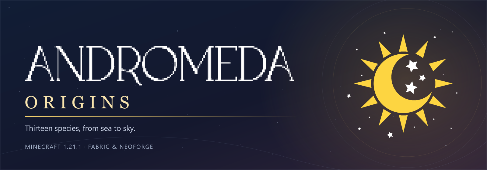

# Andromeda Origins

**Minecraft 1.21.1 · Fabric & NeoForge**

Climb walls as an Arachne, stalk prey as a Fenrkin, or slip through the Veil. Built for Andromeda MC, these **13 Origins** change how you move, fight, eat, and survive. Their advantages come with weaknesses that give each species its own place in the world.

Read your abilities in the in-game Origin reader, track cooldowns and resources on custom HUD bars, and tune individual powers through server-controlled settings. **13 Champion variants** give operators an additional set of hidden Origins to assign.

[Download on Modrinth](https://modrinth.com/mod/andromeda-origins) · [Community](https://discord.gg/pcRw79hwey)

## Origin roster

| Origin | Playstyle |
| --- | --- |
|  Arachne | Webs, climbing, venom, and swift movement |
|  Faerie | Small fae mobility, illusions, and concealment |
|  Fenrkin | Predator tracking, pursuit, and stamina |
|  Gorgon | Petrification and speed transference |
|  Humanity | Determination and a powerful final stand |
|  Lichling | Undead sustain, revival, and withering magic |
|  Manticore | Pouncing melee predator and blood-fueled combat |
|  Nereid | Aquatic healing and support |
|  Satyr | Momentum, leaps, and wind movement |
|  Selkie | Aquatic mobility, hydration, and protection |
|  Siren | Sonic control, pacification, and Silence |
|  Veilborn | Veil movement, transposition, and concealment |
|  Wyverian | Ember flames and aerial mobility |

## Installation

For **Minecraft 1.21.1 / Java 21**, install the same Andromeda version on the client and server. Choose the download for your loader and install the matching dependencies:

| Fabric | NeoForge |
| --- | --- |
| [Overgrown's Origins](https://modrinth.com/mod/overgrowns-origins/versions) | [Overgrown's Origins](https://modrinth.com/mod/overgrowns-origins/versions) |
| [Opoli](https://modrinth.com/mod/opoli/versions) | [Opoli](https://modrinth.com/mod/opoli/versions) |
| [Fzzy Config](https://modrinth.com/mod/fzzy-config/versions) | [Fzzy Config](https://modrinth.com/mod/fzzy-config/versions) |
| [Fabric Language Kotlin](https://modrinth.com/mod/fabric-language-kotlin/versions) | [Kotlin for Forge](https://modrinth.com/mod/kotlin-for-forge/versions) (complete distribution) |
| [Fabric API](https://modrinth.com/mod/fabric-api/versions) | — |

Additional Entity Attributes is bundled with Andromeda.

Use the **Overgrown fork** of Origins and Opoli. Apace's original Origins/Apoli releases use a different API. Existing legacy player data is not automatically imported; back up your world before changing frameworks.

## Configuration and Champions

Open the gameplay screen through Mod Menu when available, or use `/andromedaorigins config` with operator permission level 2. Settings are stored in `config/andromeda_origins/gameplay.toml` and apply live. Power switches preserve their stored cooldown and resource state.

The **Food Balance** section controls Farmer's Blessing, Grandma's Blessing, and Stoutheart, plus Beef Wellington nutrition and saturation. The default Wellington serving restores 6 hunger points and 6 saturation, whether eaten from an item or a placed dish. A separate switch blocks golden apples, enchanted golden apples, and golden carrots from bypassing Incapacitated. These settings apply live; the integrations are optional.

Champion variants are hidden from normal selection. Operators can assign one with:

```mcfunction
/origin set <player> origins:origin andromeda_origins:champion_fenrkin
```

## Optional integrations

**Your installed mods can change how abilities look and sound.** Andromeda includes its own sounds and base particle effects. [Spell Engine](https://modrinth.com/mod/spell-engine) adds enhanced particle layers, and [More RPG Library](https://modrinth.com/mod/more-rpg-library) supplies additional particle and sound assets. Install both libraries for the full enhanced layer. These are optional enhancements: missing or unsupported assets are skipped while the bundled effects continue. Cosmetic layers do not change ability damage, cooldowns or resource costs.

| Optional mod | What it adds or connects |
| --- | --- |
| [Spell Engine](https://modrinth.com/mod/spell-engine) + [More RPG Library](https://modrinth.com/mod/more-rpg-library) | Additional ability particles and sound layers. |
| [Incapacitated](https://modrinth.com/mod/incapacitated) | Downed-player revival abilities and the configurable golden-food bypass restriction. |
| [Figura](https://modrinth.com/mod/figura) | Avatar ability-state hooks and armor visibility support; an avatar must use these hooks to show custom animations. |
| [Iris Shaders](https://modrinth.com/mod/iris) | Connects the custom night-vision powers to shader brightness. Appearance still depends on the shader pack. |
| [Simply Swords](https://modrinth.com/mod/simply-swords) / [Simply More](https://modrinth.com/mod/simplymore) | Server-configurable weapon implicit balance and matching tooltip changes. |
| [Farm & Charm](https://modrinth.com/mod/lets-do-farm-charm), [Candlelight](https://modrinth.com/mod/lets-do-candlelight-farmcharm-compat), [Brewery](https://modrinth.com/mod/lets-do-brewery-farmcharm-compat) | Optional food nutrition and blessing-effect balance. |
| [Mod Menu](https://modrinth.com/mod/modmenu) (Fabric) | An entry point to the configuration screen. |
| [PlayerAbilityLib](https://modrinth.com/mod/pal) (Fabric) | Coordinates Veil Step with other mods’ flight grants when present. |

Choose compatible Minecraft/loader releases and install each optional mod's own dependencies. Gameplay/effect libraries belong on both client and server; Figura, Iris and Mod Menu are client integrations. Dietary and iron tags also recognize compatible modded foods and equipment.

Operators can control the cosmetic layers with `/andromedaorigins enhanced_fx enabled false`, `particles false` or `sounds false` (use `true` to re-enable). Settings are saved in `config/andromeda_origins_fx.json`. Bundled effects remain available when these extra layers are disabled.

Custom resource-pack sound layers can also run without Spell Engine. Pack authors can set the sound ID, volume and pitch in a server datapack; missing HUD textures and tooltip badge artwork have fallbacks. See [FX customization](https://github.com/BareMinimumStudios/andromeda-origins/blob/overgrown-1.21.1/ENHANCED_FX.md#custom-resource-pack-sounds) for the matching datapack/resource-pack setup.

Andromeda's code and artwork use The Bare Minimum License v1.0. Bundled third-party components retain their own licenses.
