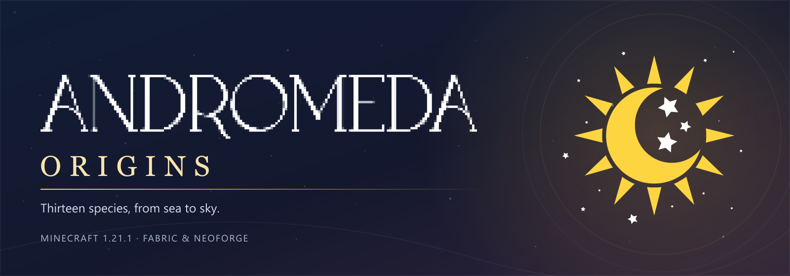

# Andromeda Origins

**Minecraft 1.21.1 · Fabric & NeoForge · Client and server**

Weave traps as an Arachne, track prey as a Fenrkin, or slip through the Veil. Built for Andromeda MC, Andromeda Origins adds **13 playable Origins**, each with its own abilities and weaknesses. The in-game Origin reader explains your kit, and custom HUD bars track resources, cooldowns and status.

[CurseForge downloads](https://www.curseforge.com/minecraft/mc-mods/andromeda-origins/files/all) · [Source and issues](https://github.com/BareMinimumStudios/andromeda-origins) · [Community](https://discord.gg/pcRw79hwey)

## Origin roster

| Origin | Playstyle |
| --- | --- |
|  Arachne | Climb walls, weave traps and move freely through vanilla and Chipped cobwebs |
|  Faerie | Small fae mobility, illusions, and concealment |
|  Fenrkin | Predator tracking, pursuit, and stamina |
|  Gorgon | Petrification and speed transference |
|  Humanity | Determination and a powerful final stand |
|  Lichling | Undead sustain, revival, and withering magic |
|  Manticore | Pouncing melee predator and blood-fueled combat |
|  Nereid | Heal allies, mark targets with kelp and pull foes under with Submersion |
|  Satyr | Momentum, leaps, and wind movement |
|  Selkie | Fast swimming, five minutes of land hydration and protective tides |
|  Siren | Sonic control, pacification, and Silence |
|  Veilborn | Veil movement, transposition, and concealment |
|  Wyverian | Breathe fire and use Wind Burst while gliding |

Dietary Origins can eat any food. Off-diet food restores **25% of its normal hunger and saturation**, with hunger rounded down. Diet-exempt foods and drinks keep their exemptions.

## Installation

For **Minecraft 1.21.1 / Java 21**, install the same Andromeda version on the client and server. Choose the download for your loader and install the matching dependencies:

| Fabric | NeoForge |
| --- | --- |
| [Overgrown's Origins](https://modrinth.com/mod/overgrowns-origins/versions) | [Overgrown's Origins](https://modrinth.com/mod/overgrowns-origins/versions) |
| [Opoli](https://modrinth.com/mod/opoli/versions) | [Opoli](https://modrinth.com/mod/opoli/versions) |
| [Fzzy Config](https://modrinth.com/mod/fzzy-config/versions) | [Fzzy Config](https://modrinth.com/mod/fzzy-config/versions) |
| [Fabric Language Kotlin](https://modrinth.com/mod/fabric-language-kotlin/versions) | [Kotlin for Forge](https://modrinth.com/mod/kotlin-for-forge/versions) (complete distribution) |
| [Fabric API](https://modrinth.com/mod/fabric-api/versions) | — |

Additional Entity Attributes is bundled with Andromeda.

Use the **Overgrown fork** of Origins and Opoli. Apace's original Origins/Apoli releases use a different API. Existing legacy player data is not automatically imported; back up your world before changing frameworks.

## Controls and effects

- Use the Origins **Primary** and **Secondary Ability** keys. **Origin Toggle** defaults to **C** and can be rebound in Controls.
- Server owners can choose **Minimal**, **Standard** or **Cinematic** presentation. Standard balances animated accents with textured water, mist and sparks when the optional libraries are installed. Cinematic adds detail, and reduced cosmetic flashes are on by default.
- Use `/andromedaorigins_visuals` to adjust local visual preferences, including contours and Dawnbreaker impact frames. Impact frames require the server switch and local opt-in.

## Server configuration

Operators can use `/andromedaorigins config` (permission level 2). The gameplay settings in `config/andromeda_origins/gameplay.toml` let you enable or disable individual Origins and powers. Power switches preserve stored cooldowns and resources.

Optional balance settings cover selected Simply Swords and Simply More weapon effects, Let's Do blessings, Beef Wellington nutrition, and whether golden apples, enchanted golden apples or golden carrots can bypass Incapacitated. For player recovery and legacy migration, see the [gameplay and admin guide](https://github.com/BareMinimumStudios/andromeda-origins/blob/overgrown-1.21.1/docs/GAMEPLAY.md#admin-recovery-command).

## Hidden Origins

Operators can assign any of the **13 Champion variants** with the Origins command. **Dawnbreaker** is a separate Origin available by command, with a radiant aura, group petrification, a light bow, Measured Step, Kneel, Stillwater Guard and Begone. Stillwater freezes incoming projectiles and redirects them on release. Begone immediately displaces its target 500 blocks at the same height.

```mcfunction
/origin set <player> origins:origin andromeda_origins:champion_fenrkin
/origin set <player> origins:origin andromeda_origins:dawnbreaker
```

Dawnbreaker's abilities have separate keybinds and server switches. See [Champion and Dawnbreaker abilities](https://github.com/BareMinimumStudios/andromeda-origins/blob/overgrown-1.21.1/CHAMPION_ORIGINS.md) for the full kits.

## Optional integrations

Andromeda includes its own sounds and visual effects. Compatible optional mods can add textures, particles and audio. Supported sound events and effect palettes can also be customized with packs.

| Optional mod | What it adds or connects |
| --- | --- |
| [Spell Engine](https://modrinth.com/mod/spell-engine) + [More RPG Library](https://modrinth.com/mod/more-rpg-library) | Additional ability particles and sound layers. |
| [Incapacitated](https://modrinth.com/mod/incapacitated) | Downed-player revival abilities and the configurable golden-food bypass restriction. |
| [Afterimages](https://modrinth.com/mod/afterimages) (client) | Optional gold departure silhouettes for Measured Step; not required on the server. |
| [Figura](https://modrinth.com/mod/figura) | Avatar ability-state hooks and armor visibility support; an avatar must use these hooks to show custom animations. |
| [Iris Shaders](https://modrinth.com/mod/iris) | Connects the custom night-vision powers to shader brightness. Appearance still depends on the shader pack. |
| [Simply Swords](https://modrinth.com/mod/simply-swords) / [Simply More](https://modrinth.com/mod/simplymore) | Configurable weapon implicit effects and matching tooltips. Simply Swords also supplies optional Dawnquiver visuals and audio for Dawnbreaker. |
| [Farm & Charm](https://modrinth.com/mod/lets-do-farm-charm), [Candlelight](https://modrinth.com/mod/lets-do-candlelight-farmcharm-compat), [Brewery](https://modrinth.com/mod/lets-do-brewery-farmcharm-compat) | Optional food nutrition and blessing-effect balance. |
| [Mod Menu](https://modrinth.com/mod/modmenu) (Fabric) | An entry point to the configuration screen. |
| [PlayerAbilityLib](https://modrinth.com/mod/pal) (Fabric) | Coordinates Veil Step with other mods’ flight grants when present. |
| [Chipped](https://modrinth.com/mod/chipped) | Arachne treats its cobweb variants like vanilla webs for movement, climbing, sensing and attacking through them. |

Choose versions for your loader. Install gameplay integrations and shared effect libraries on both client and server. Afterimages, Figura's avatar integration, Iris and Mod Menu affect the client experience.

## More information

- [Gameplay, controls and configuration](https://github.com/BareMinimumStudios/andromeda-origins/blob/overgrown-1.21.1/docs/GAMEPLAY.md)
- [Compatibility](https://github.com/BareMinimumStudios/andromeda-origins/blob/overgrown-1.21.1/COMPATIBILITY.md) · [Customize ability effects and sounds](https://github.com/BareMinimumStudios/andromeda-origins/blob/overgrown-1.21.1/ENHANCED_FX.md) · [Release history](https://github.com/BareMinimumStudios/andromeda-origins/blob/overgrown-1.21.1/CHANGELOG.md)

Andromeda's code and artwork use [The Bare Minimum License v1.0](https://github.com/BareMinimumStudios/andromeda-origins/blob/overgrown-1.21.1/LICENSE). Bundled third-party components retain their own licenses.

## Sponsor

[](https://bisecthosting.com/bareminimum)

Use code `bareminimum` to get 25% off your first month.
